<picture>
  <source media="(prefers-color-scheme: dark)" srcset="./dark.svg">
  <source media="(prefers-color-scheme: light)" srcset="./light.svg">
  
</picture>

 

---

## 👋 Hi, I'm Sumit

Software Developer Intern and recent **B.Tech Computer Science & Engineering graduate (2026)**, focused on **full-stack web development with the MERN stack**.

Right now I'm working as a **Software Developer Intern at Junk It Out Technologies**, where I contribute to real-world web projects, take part in code reviews, and learn from experienced developers.

I want to grow as a software developer and build reliable web applications. I'm open to **full-stack and software developer roles**. The best way to reach me is a LinkedIn message.

---

## 🧭 Focus

- 🌐 Full-stack web apps with **MongoDB, Express, React and Node.js**
- ⚡ Learning and building with **Next.js** (App Router), **Prisma** and **Tailwind CSS**
- ☕ **Java**, OOP and Data Structures & Algorithms (**300+ problems solved**)
- 🔐 REST APIs, JWT authentication and database design

---

## 💼 Experience

| Role | Where | When | What I did |
|---|---|---|---|
| **Software Developer Intern** | Junk It Out Technologies | Current | Contributing to real-world web projects, taking part in code reviews, learning from experienced developers |
| **Vocational Training – Web Development** | CSIR-CIMFR, Dhanbad | Jun – Jul 2025 | Built the frontend and REST APIs of a full-stack iron ore classification system (React, Flask, MongoDB), integrated YOLOv5 and ResNet18 models, added JWT authentication and a live monitoring dashboard |
| **Web Developer Intern (Remote)** | AppThing | Dec 2023 – Feb 2024 | Built responsive UI components with HTML, CSS, JavaScript and React; found and fixed UI and logic bugs; worked with code-review practices |

---

## 🚀 Featured Projects

| Project | What it is | Tech | Links |
|---|---|---|---|
| **ProShop** | Full-stack MERN e-commerce platform with cart, secure checkout, PayPal sandbox, product reviews and ratings, admin panel and image uploads | React, Redux Toolkit, Node.js, Express, MongoDB, Multer | [Live](https://proshop-ecommerce-5.onrender.com/) |
| **SAMS** (Student Attendance Management System) | Final-year project. Attendance with face recognition and eye-blink liveness detection to reduce proxy attendance, role-based auth, admin dashboard, attendance history and CSV export | MERN, face-api.js | [Live](https://student-attendance-management-system-eurb.onrender.com/) |
| **Wanderlust** | Airbnb-style booking marketplace with user auth, CRUD for listings and dynamic routing | Node.js, Express, MongoDB, Mongoose, EJS, Bootstrap, Passport.js | [Live](https://majorproject-p8s3.onrender.com/listings) |
| **Hospital Management System** | MERN app with authentication, REST APIs and appointment scheduling | MERN | – |

> The free Render hosting may take a few seconds to wake up on the first visit.

---

## 🛠️ Engineering Stack

**Languages**

**Frontend**

**Backend and APIs**

**Databases and ORMs**

**Tools**

**CS fundamentals:** Data Structures & Algorithms · OOP · DBMS · Operating Systems · Computer Networks

**Currently learning:** Spring Boot · Spring MVC · Hibernate/JPA · Next.js (advanced)

---

## 🎓 Education

**B.Tech in Computer Science and Engineering** (2022 – 2026)
University College of Engineering and Technology (VBU), Jharkhand · CGPA 7.87 / 10

**Certification:** Web Development Training, NullClass

---

## 📊 GitHub Stats

---

<h2 align="center">📊 GitHub Contributions</h2>

  <picture>
    <source media="(prefers-color-scheme: dark)" srcset="https://raw.githubusercontent.com/SumitKumarSoftwareEngineer/github-snake/output/github-snake-dark.svg" />
    <source media="(prefers-color-scheme: light)" srcset="https://raw.githubusercontent.com/SumitKumarSoftwareEngineer/github-snake/output/github-snake.svg" />
    
  </picture>

---

## 📫 Connect With Me

*Open to full-stack and software developer roles. Let's build something reliable.*

